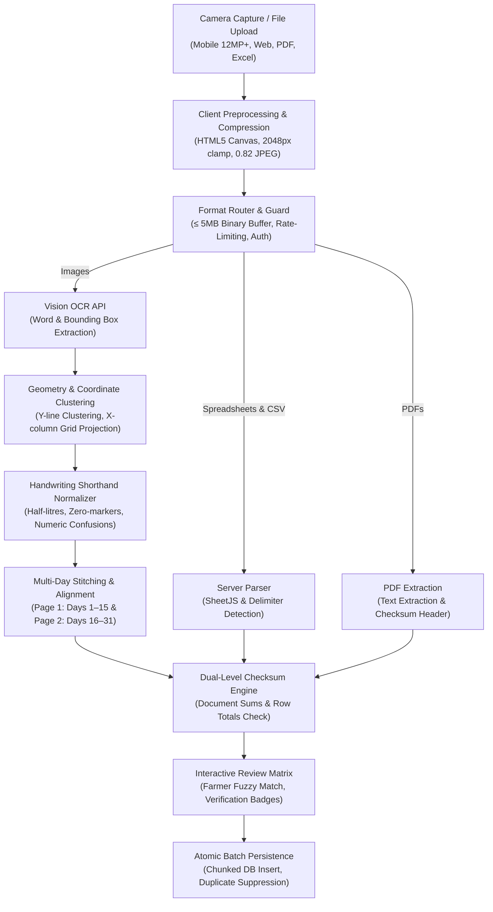

# IHURIRO RY'AMATA — OCR & Milk Register Processing Architecture

**Target Launch**: November 1, 2026  
**System Status**: Production-Hardened  
**Primary Engine**: Cloud Vision / Local Multimodal OCR with Geometry & Checksum Clustering  
**Supported Formats**: Photos (`.jpg`, `.jpeg`, `.png`, `.webp`), Documents (`.pdf`), Tabular Spreadsheets (`.xlsx`, `.xls`, `.csv`, `.txt`)

---

## 1. Architectural Overview & Pipeline Topology

Physical milk collection in Rwanda relies heavily on handwritten paper registers (*Amakayi y'Amata*), maintained daily by milk collectors (*Abacunda*) and collection center operators (*Amakusanyirizo*). 

The IHURIRO RY'AMATA OCR architecture transforms noisy, handwritten physical notebook scans, mobile camera captures, PDFs, and spreadsheets into clean, verified database transactions without losing accounting integrity or violating date identities.

---

## 2. Preprocessing & Memory Defense

### 2.1 Client-Side HTML5 Canvas Compression
Smartphones commonly capture 12MP to 48MP photos (8MB to 20MB uncompressed). Transmitting these raw images directly causes mobile browser out-of-memory crashes and HTTP 413 / Gateway timeouts.

- **Implementation**: Located in `lib/imports/client-files.ts` (`compressImageForOcr`).
- **Resizing Algorithm**: Clamps the longest edge to `maxWidth = 2048px` while preserving the exact aspect ratio.
- **Compression**: Encodes as image/jpeg at `0.82` quality.
- **Memory Footprint**: Reduces payload size from 12MB+ down to ~600KB–1.2MB, maintaining sharp contrast on handwritten numerals while drastically speeding up OCR inference.

### 2.2 Half-Month Register Separation
Handwritten notebooks are laid out across physical spreads (Page 1 = Days 1–15; Page 2 = Days 16–31).
- **Golden Rule**: Collectors must never photograph both facing pages simultaneously. Capturing a two-page spread halves the effective pixel density on handwritten digits and creates severe perspective distortion.
- **UI Enforcements**:
  - `[ Urupapuro rw'Ibumoso: Iminsi 1–15 ]`
  - `[ Urupapuro rw'Iburyo: Iminsi 16–31 ]`
  - Prominent guidance warning: *"Ntukafotore amapaji abiri icyarimwe. Buri rupapuro rugomba gufatwa ukwarwo kugira ngo imibare isomeke neza."*

---

## 3. Multi-Format Ingestion Engine

| Format | Ingestion Path | Text Extraction Mechanism | Checksum Discovery |
| :--- | :--- | :--- | :--- |
| **Photos (JPEG, PNG, WebP)** | `/api/imports/ocr` | Cloud Vision OCR words + bounding polygons $(x, y, w, h)$ | Physical row totals (`= 45`) & bottom subtotal rows (`IGITERANYO`) |
| **Spreadsheets (.xlsx, .xls)** | `/api/imports/extract` | SheetJS streaming workbook parser | Bottom row checksums (`stripSummaryRows`) |
| **Delimited (.csv, .txt)** | `/api/imports/extract` | RFC 4180 streaming delimiter detector (`,`, `;`, `\t`) | Summary checksum extraction |
| **PDF Documents (.pdf)** | `/api/imports/extract` | PDF.js page-by-page text stream | Regex extraction on trailing document lines |

---

## 4. Coordinate Clustering & Cell Geometry Projection

Raw OCR yields an unordered collection of word tokens with normalized bounding boxes:
$$\text{Token} = \{ \text{text}, x, y, \text{width}, \text{height}, \text{confidence} \}$$

### 4.1 Dynamic Line Clustering ($Y$-Axis)
1. **Vertical Sorting**: Words are sorted primarily by $y$-coordinate.
2. **Dynamic Height Windows**: Two consecutive words belong to the same text row if:
   $$|y_1 - y_2| \le \text{threshold} \quad (\text{typically } 0.6 \times \text{median line height})$$
3. **Subline Detection**: Secondary text located immediately beneath a farmer's name (e.g., phone `078...` or National ID `119...`) is merged into `sublineMetadata` rather than creating a phantom milk delivery row.

### 4.2 Date Column Grid Anchor ($X$-Axis)
1. Header scanning locates date tokens (e.g. `1`, `2`, `3` ... `15`, `16`, `17` or formatted dates `12/10`, `13/10`).
2. Each date column establishes an $X$-center anchor.
3. Daily milk delivery quantities are mapped to the nearest $X$-column within the bounding horizontal tolerance.
4. **Accounting Date Identity**: The date column printed in the register is strictly preserved as the transaction date in the database. The physical scan date is never substituted.

---

## 5. Handwriting Normalization & Shorthand Heuristics

Milk collectors operate in fast-paced morning/evening environments and use established local shorthands:

| Shorthand / Raw Token | Meaning | Normalized Value | Pipeline Status |
| :--- | :--- | :--- | :--- |
| `1^`, `1'`, `1,5`, `1 1/2` | One and a half litres | `1.5` | `ok` |
| `2^`, `2'` | Two and a half litres | `2.5` | `ok` |
| `1/2`, `1/4`, `3/4` | Fractional deliveries | `0.5`, `0.25`, `0.75` | `ok` |
| `-`, `—`, `–`, `X`, `x` | Absent / No delivery (cow gave 0L) | `0` (`missed: true`) | `ok` (zero delivery confirmed) |
| `0`, `0.0`, `0,0` | Ambiguous numeric zero | `null` | `unreadable` (requires user review) |
| `O`, `o` in numeric column | OCR confusion for zero | `0` | Corrected via `correctNumericOcrConfusion` |
| `l`, `I`, `|` in numeric column | OCR confusion for digit 1 | `1` | Corrected via `correctNumericOcrConfusion` |
| `S`, `s` in numeric column | OCR confusion for digit 5 | `5` | Corrected via `correctNumericOcrConfusion` |
| `B` in numeric column | OCR confusion for digit 8 | `8` | Corrected via `correctNumericOcrConfusion` |

---

## 6. Dual-Level Checksum Engine

Accounting integrity is enforced via a two-tier mathematical checksum system:

### 6.1 Level 1: Page & Document Checksums
- Registers conclude with a summary row labeled `TOTAL`, `IGITERANYO`, `SUBTOTAL`, `SOUS-TOTAL`, or `YOSE HAMWE`.
- `stripSummaryRows` separates this row from the data rows, ensuring it is **never** inserted into the database as a farmer or milk entry.
- The summary row's recorded numbers are extracted as `{ checksumLiters, checksumGross, checksumNet }`.
- When displayed in the review header, the sum of all parsed row deliveries $\sum \text{Liters}$ is compared against `checksumLiters`.

### 6.2 Level 2: Row-Level Sum Checksum
In multi-day registers, collectors frequently calculate and write a row total on the right margin (e.g. `= 45`, `Tot: 60.5`, `) 32`):

$$\Delta_{\text{row}} = \left| \sum_{d=1}^{n} (\text{morning}_d + \text{evening}_d) - \text{Total}_{\text{recorded}} \right|$$

1. **Verified Match** ($\Delta_{\text{row}} < 0.05$):
   - Row displays a green **✓ Yemejwe / Verified** badge.
   - The user has high confidence that all daily handwriting entries were correctly recognized.
2. **Checksum Mismatch** ($\Delta_{\text{row}} \ge 0.05$):
   - Row displays an amber warning badge: **⚠️ Total idahuye (X L vs Y L) / Mismatch**.
   - The row is automatically flagged for review (`status: 'review'`) so the operator can inspect and correct the erroneous day before saving.

---

## 7. Security, Rate Limiting & Safety Boundaries

1. **Route Directives**:
   - `/api/imports/ocr`: Configured with `export const runtime = 'nodejs'`, `export const dynamic = 'force-dynamic'`, and `export const maxDuration = 60`.
2. **Buffer Defense**:
   - Base64 payloads are validated to ensure the underlying image binary does not exceed `5MB`. Payloads exceeding 5MB are rejected immediately with HTTP 413 `OCR_IMAGE_TOO_LARGE`.
3. **Sliding-Window Rate Limiting**:
   - Up to 12 OCR scans per minute per authenticated user. Protects against accidental camera loop spam and upstream quota exhaustion.
4. **Authorization & Tenant Isolation**:
   - Restricted strictly to `COLLECTOR` and `COLLECTION_CENTER` account types with active subscription tiers (`requireActiveSubscription`).
5. **Rogue Summary Row Hardening**:
   - Validated at the ingestion boundary, client matching layer, and `farmer-service.js` domain layer (`normalizeFarmerInput`). Any row matching `SUMMARY_ROW_PATTERN` is strictly blocked from database insertion.
