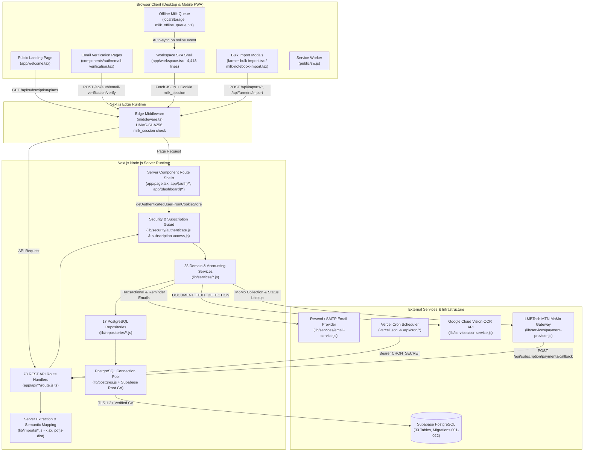
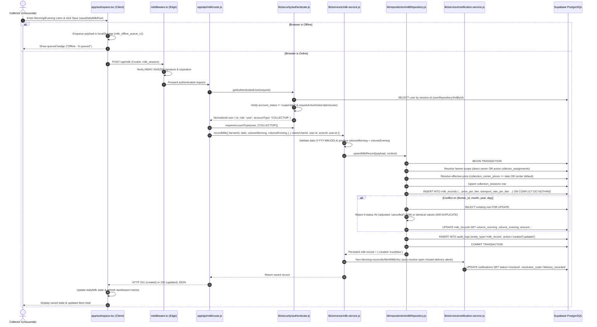
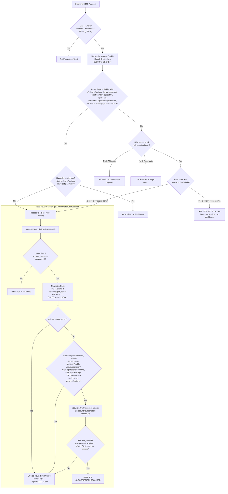
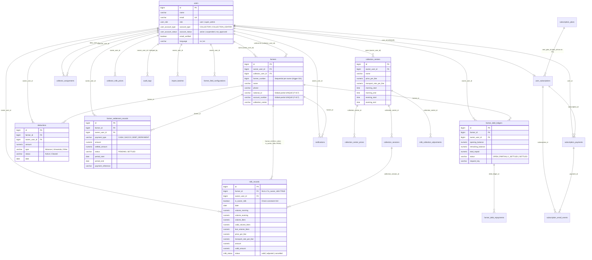
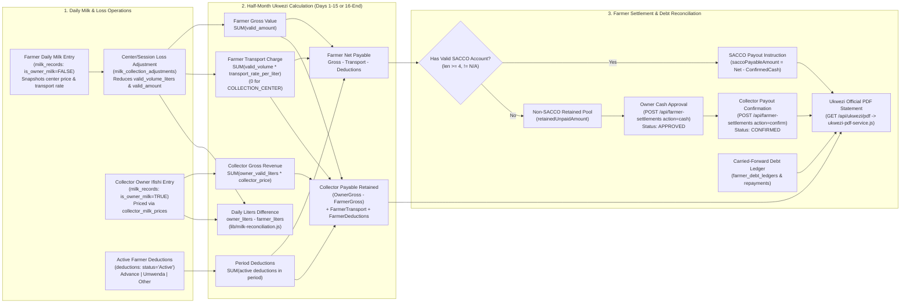

# 02 — System Architecture & End-to-End Traceability

## 1. High-Level System Architecture

**IHURIRO RY'AMATA (Milk System)** is a full-stack monolithic Next.js 14 application deployed on Node.js (with Vercel Cron integration) and backed by a Supabase-hosted PostgreSQL database accessed directly via `pg.Pool` (`lib/postgres.js`).

---

## 2. Frontend-to-Backend Request Flow

The sequence diagram below traces a representative operational workflow—recording a daily farmer milk delivery (`POST /api/milk`)—from user interaction in `app/workspace.tsx` to PostgreSQL transaction commit, operational alert auto-resolution, and UI update.

---

## 3. Authentication, Session, and Authorization Flow

Authentication is 100% custom and PostgreSQL-backed (`users` table + `bcryptjs` password hashes + HMAC-SHA256 `milk_session` cookies). Despite `@supabase/ssr` being present in `package.json`, Supabase Auth is **not** used.

---

## 4. Verified Entity-Relationship (ER) Diagram

The ER diagram below reflects the actual PostgreSQL schema created across migrations `001`–`022` (28 active tables shown; 5 unused legacy tables `session_store`, `payment_methods`, `subscription_usage_snapshots`, `collector_milk_records`, and `farmer_payments` are documented in `05-database-and-data-model.md`).

---

## 5. Operational & Ukwezi Accounting Workflow

The diagram below traces how daily milk entries, center-level loss adjustments, collector Owner Ifishi entries, transport rate snapshots, active deductions, SACCO eligibility, cash approvals, and debt ledgers combine into the half-month **Ukwezi** reconciliation (`lib/services/monthly-report-service.js`).

---

## 6. Architectural Characteristics: Caching, Transactions, Idempotency & Failure Modes

1. **Server Components vs. Client Components**:
   - All Next.js page files (`app/page.tsx`, `app/(auth)/**/page.tsx`, `app/(dashboard)/dashboard/page.tsx`) are minimal Server Components that check session cookies (`getAuthenticatedUserFromCookieStore`) for initial redirects and render Client Components (`<Welcome />`, `<Workspace />`, `<EmailVerificationPage />`).
   - All data fetching after initial page load occurs client-side via `fetch('/api/...')` with `cache: 'no-store'` inside `app/workspace.tsx` (`line 781`).
2. **Transaction Boundaries & Row Locking**:
   - Multi-step writes in `lib/repositories/*.js` use explicit `BEGIN` / `COMMIT` / `ROLLBACK` transactions on a checked-out `pg` client (`pool.connect()`), combining `pg_advisory_xact_lock` (for farmer numbering, Owner Ifishi daily writes, center loss adjustments, and debt requests) and `SELECT ... FOR UPDATE` / `FOR KEY SHARE` row locks.
   - **Exception (`F-015`)**: `POST /api/farmer-settlements` (`action === 'cash'`) computes net payable and existing cash approvals outside the `createSettlementRecord` transaction.
3. **Idempotency & Duplicate Submission Protection**:
   - **Farmer Settlements & Debts**: Uses client-generated `requestKey` (`crypto.randomUUID()`) persisted in `farmer_settlement_records.payment_reference` (`uq_farmer_settlement_reference`), `farmer_debt_ledgers.request_key` (`uq_farmer_debt_request_key`), and `farmer_debt_repayments.request_key`.
   - **Bulk Farmer Import**: Uses `import_batches (owner_user_id, batch_key)` per 50-row chunk (`019_import_batches.sql`).
   - **Milk Notebook Import (`F-027`)**: Does **not** use `import_batches`; relies on `strictInsert` conflict checks on `(farmer_id, month, year, day)`.
   - **Subscription Payments**: Reuses active `PENDING` payments for the same user and reconciles with LMBTech before creating a new collection request; enforces unique `(provider, provider_reference)` and `(provider, provider_transaction_id)`.
   - **Scheduled Cron Jobs**: `lib/repositories/jobRunRepository.js` uses session-level `pg_try_advisory_lock(hashtext(jobId))` so overlapping cron invocations skip cleanly (`{ skipped: true, reason: 'already_running' }`).
