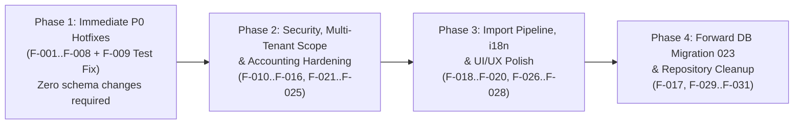

# 11 — Complete Findings Register and Prioritized Improvement Roadmap

## 1. Classification & Priority Definitions

Every finding below is backed by direct code/test evidence and classified along two dimensions:
- **Priority Level**:
  - **P0 — Critical Blockers**: Runtime crashes (`500`), broken core user workflows, or severe accounting/data corruption risks.
  - **P1 — High Priority**: Broken business rules, security/authorization gaps, failing automated tests, or severe Kinyarwanda mistranslations.
  - **P2 — Medium Priority**: Edge-case data consistency issues, health-check drift, performance bottlenecks (N+1 queries), and UI/UX/localization polish.
  - **P3 — Low Priority**: Schema index hygiene, dead/backup file cleanup, developer scripts, and documentation drift.
- **Environment Scope Classification**:
  - **LOCAL-CODE**: Reproducible and fixable purely in repository source code and unit/E2E tests.
  - **CONFIG-DEPENDENT**: Depends on `.env.local` / external service credentials (e.g., Resend sender domain, Google Vision OCR key, LMBTech credentials).
  - **DEPLOYMENT-ONLY**: Requires production/Supabase database migration execution or hosting scheduler configuration (`vercel.json`).

---

## 2. Master Findings Register (`F-001` – `F-031`)

### P0 — Critical Blockers (8 Findings)

#### `F-001` — `PUT /api/milk/[id]` and `DELETE /api/milk/[id]` Crash with `ReferenceError`
- **Priority / Severity**: P0 / Critical (`LOCAL-CODE`)
- **Category**: Backend API / Milk Collection
- **Evidence**: [`app/api/milk/[id]/route.js:1-6, 34, 56`](file:///d:/ihuriroryamata.com/app/api/milk/%5Bid%5D/route.js#L1-L56)
- **Description & Root Cause**: Line 2 imports `{ getAuthenticatedUser, requireAccountType }` from `@/lib/security/authenticate.js`, omitting `requireActiveSubscription`. However, `PUT` (line 34) and `DELETE` (line 56) call `await requireActiveSubscription(user)`. Every request to update or void an individual farmer milk record throws `ReferenceError: requireActiveSubscription is not defined` and returns HTTP `500`.
- **User Impact**: Collectors cannot edit or void individual milk records via `/api/milk/[id]`.
- **Minimal Safe Fix**: Import `requireActiveSubscription` from `@/lib/security/subscription-access.js` (or `@/lib/security/authenticate.js`) in `app/api/milk/[id]/route.js` (note: `getAuthenticatedUser(request)` already calls `requireActiveSubscription(user)`).
- **Dependencies**: Pair with `F-013` (assigned collector scope resolution in `app/api/milk/[id]/route.js`).
- **Regression Test**: Add route-level unit tests invoking `PUT` and `DELETE` handlers exported by `app/api/milk/[id]/route.js`.
- **Status**: `OPEN`

#### `F-002` — `PUT /api/deductions/[id]` and `DELETE /api/deductions/[id]` Crash with `ReferenceError`
- **Priority / Severity**: P0 / Critical (`LOCAL-CODE`)
- **Category**: Backend API / Deductions
- **Evidence**: [`app/api/deductions/[id]/route.js:1-6, 31, 50`](file:///d:/ihuriroryamata.com/app/api/deductions/%5Bid%5D/route.js#L1-L50)
- **Description & Root Cause**: `PUT` (line 31) and `DELETE` (line 50) call `await requireActiveSubscription(user)`, which is not imported in `app/api/deductions/[id]/route.js`. Every call throws `ReferenceError: requireActiveSubscription is not defined` (`500`).
- **User Impact**: Updating or soft-clearing (`status = 'Cleared'`) any deduction via `/api/deductions/[id]` always fails with HTTP `500`.
- **Minimal Safe Fix**: Import `requireActiveSubscription` in `app/api/deductions/[id]/route.js`.
- **Dependencies**: Pair with `F-013`.
- **Regression Test**: Add route-handler tests for `PUT` and `DELETE` in `tests/deductions.test.js`.
- **Status**: `OPEN`

#### `F-003` — `DELETE /api/collector-assignments/[collectorUserId]` Crashes with `ReferenceError`
- **Priority / Severity**: P0 / Critical (`LOCAL-CODE`)
- **Category**: Backend API / Collector Assignments
- **Evidence**: [`app/api/collector-assignments/[collectorUserId]/route.js:1-15`](file:///d:/ihuriroryamata.com/app/api/collector-assignments/%5BcollectorUserId%5D/route.js#L1-L15)
- **Description & Root Cause**: Line 1 imports only `{ getAuthenticatedUser }` from `@/lib/security/authenticate.js`, but lines 12–13 call `requireAccountType(user, ['COLLECTOR', 'COLLECTION_CENTER'])` and `await requireActiveSubscription(user)`. Every `DELETE` request throws `ReferenceError: requireAccountType is not defined` (`500`).
- **User Impact**: Collection Center owners clicking "Revoke" on an assigned Collector in the `Abacunda` tab (`renderCenters`) always receive a `500` error.
- **Minimal Safe Fix**: Import `requireAccountType` and `requireActiveSubscription` and restrict `DELETE` to `requireAccountType(user, 'COLLECTION_CENTER')`.
- **Dependencies**: Pair with `F-011`.
- **Regression Test**: Add route-level `DELETE` handler execution test in `tests/collector-assignments.test.js`.
- **Status**: `OPEN`

#### `F-004` — Scheduled Notification Cron `/api/cron/notifications` Crashes with `TypeError`
- **Priority / Severity**: P0 / Critical (`LOCAL-CODE`)
- **Category**: Background Jobs / Operational Alerts
- **Evidence**: [`app/api/cron/notifications/route.js:6, 33`](file:///d:/ihuriroryamata.com/app/api/cron/notifications/route.js#L6-L33)
- **Description & Root Cause**: Line 6 destructures `const { repository: UserRepository } = require('@/lib/repositories/userRepository.js')`, where `UserRepository` is already the `repository` object. Line 33 calls `await UserRepository.repository.getActiveUsers()`, throwing `TypeError: Cannot read properties of undefined (reading 'getActiveUsers')`.
- **User Impact**: Background operational alert evaluation cron job fails 100% of the time when invoked.
- **Minimal Safe Fix**: Change line 33 to `await UserRepository.getActiveUsers()` (and add `/api/cron/notifications` schedule to `vercel.json` if scheduled evaluation is desired in deployment).
- **Dependencies**: `F-009`.
- **Regression Test**: Execute the `GET`/`POST` route handler of `app/api/cron/notifications/route.js` in `tests/cron-routes.test.js` with a mocked `UserRepository`.
- **Status**: `OPEN`

#### `F-005` — Farmer Bulk Import Rejects Real Kinyarwanda Table Headers Before Semantic Mapping Runs
- **Priority / Severity**: P0 / Critical (`LOCAL-CODE`)
- **Category**: Farmer Import / Semantic Column Mapping
- **Evidence**: [`components/imports/farmer-bulk-import.tsx:381-385`](file:///d:/ihuriroryamata.com/components/imports/farmer-bulk-import.tsx#L381-L385), [`lib/imports/text-parsing.js:14-48, 141-149`](file:///d:/ihuriroryamata.com/lib/imports/text-parsing.js#L14-L48), [`lib/imports/semantic-mapping.js:28-63, 188-209`](file:///d:/ihuriroryamata.com/lib/imports/semantic-mapping.js#L28-L63)
- **Description & Root Cause**: `FarmerBulkImportModal.prepareTable` calls `detectHeader(clean)` from `lib/imports/text-parsing.js` to decide if row 0 is a header row before calling `interpretColumns(headings)` from `lib/imports/semantic-mapping.js`. Because `text-parsing.js` uses an outdated exact-match dictionary that lacks `NO` (`farmerNumber`), `AMAZINA YOMBI Y'UMWOROZI`, `NOMERO Y'INDANGAMUNTU`, and `NO YA KONTI`, a standard Rwandan cooperative table `NO | AMAZINA YOMBI Y'UMWOROZI | NOMERO Y'INDANGAMUNTU | TELEPHONE | NO YA KONTI` matches only 1 column (`TELEPHONE`), fails the `matches >= 2` threshold, sets `hasHeader = false`, replaces all headings with `"Column 1".."Column 5"`, injects the header row into `dataRows` as Farmer Row #1, and leaves all 5 columns unmapped (`confidence: 'none'`).
- **User Impact**: Importing standard Kinyarwanda farmer lists (via CSV, Excel, PDF, Paste, or OCR) fails to recognize headers, corrupts Row #1 with header text, and forces manual mapping of generic `"Column 1..5"` labels.
- **Minimal Safe Fix**: Replace the legacy `matchHeaderField` in `lib/imports/text-parsing.js:141-149` with `interpretHeading` / `interpretColumns` from `lib/imports/semantic-mapping.js` (counting columns where `confidence === 'high' || confidence === 'medium'`), and expose a user toggle ("First row contains column headers") in Step 1 of `farmer-bulk-import.tsx`.
- **Dependencies**: None.
- **Regression Test**: Add an integration test in `tests/import-semantic-mapping.test.js` testing `detectHeader` + `interpretColumns` end-to-end on `['NO', "AMAZINA YOMBI Y'UMWOROZI", "NOMERO Y'INDANGAMUNTU", 'TELEPHONE', 'NO YA KONTI']`.
- **Status**: `OPEN`

#### `F-006` — Farmer Bulk Import Locks Out Editing and Retrying Failed Rows After First Save Attempt
- **Priority / Severity**: P0 / Critical (`LOCAL-CODE`)
- **Category**: Farmer Import / Failed-Row Recovery
- **Evidence**: [`components/imports/farmer-bulk-import.tsx:691-717, 745-810, 878-889, 1074-1104`](file:///d:/ihuriroryamata.com/components/imports/farmer-bulk-import.tsx#L691-L810)
- **Description & Root Cause**: `startSave()` sets `setSaveAttempted(true)` (`L750`). Every row edit handler (`updateRowValue`, `updateRowCenter`, `toggleInclude`) aborts if `saveAttempted` is true; all inputs, checkboxes, Remove buttons, and the Save button have `disabled={saveRunning || saveAttempted}`; and `startSave()` unconditionally advances to Step 4 (`setStep(4)` at `L794`) where there is no "Back to review" button.
- **User Impact**: If any rows fail server validation or duplicate constraints (or a network glitch occurs), the user cannot edit, exclude, or retry the failed rows and must restart the entire import from Step 1.
- **Minimal Safe Fix**: Lock only rows where `row.saveOutcome === 'created'` (and auto-uncheck created rows so they are not re-submitted), keep failed/unsaved rows editable and retryable with a fresh `batchKey` on retry, and add a `"Review failed rows"` button on Step 4 when `saveProgress.failed > 0` (matching `MilkNotebookImportModal`).
- **Dependencies**: None.
- **Regression Test**: Add a test verifying that after a partial batch failure, created rows are locked/unchecked while failed rows remain editable and retryable.
- **Status**: `OPEN`

#### `F-007` — Standalone Collector Subscription Milk Usage Always Computes as `0 L` When Only Farmer Milk Is Recorded
- **Priority / Severity**: P0 / Critical (`LOCAL-CODE`)
- **Category**: Subscriptions & Billing / Accounting
- **Evidence**: [`lib/repositories/subscriptionRepository.js:412-430`](file:///d:/ihuriroryamata.com/lib/repositories/subscriptionRepository.js#L412-L430), [`lib/services/subscription-service.js:126-135`](file:///d:/ihuriroryamata.com/lib/services/subscription-service.js#L126-L135)
- **Description & Root Cause**: `buildFarmerMilkUsageQuery` inner-joins `JOIN collector_assignments ca ON ca.dairy_user_id = f.owner_user_id AND ca.collector_user_id = f.collector_user_id WHERE ca.collector_user_id = $1` (and also omits `AND ca.revoked_at IS NULL`). For standalone Collectors who own their farmers directly (`f.owner_user_id = collector.id` and `f.collector_user_id IS NULL`), `getFarmerMilkUsage` always returns `0`, so `getUsage` falls back to `getCollectorMilk` (`is_owner_milk = TRUE`), ignoring all farmer milk records unless Owner Ifishi is also entered.
- **User Impact**: Standalone Collectors see `0 L` usage on the Billing tab and are always placed in the lowest subscription tier (`USAGE_0_5000_MONTHLY`, `5,000 RWF`) regardless of how much farmer milk they collect; conversely, Collectors with revoked dairy assignments still have old dairy farmers counted against their usage.
- **Minimal Safe Fix**: Update `buildFarmerMilkUsageQuery` in `lib/repositories/subscriptionRepository.js:412-430` to use `LEFT JOIN collector_assignments ca ON ca.dairy_user_id = f.owner_user_id AND ca.collector_user_id = f.collector_user_id AND ca.revoked_at IS NULL` and filter `WHERE (f.owner_user_id = $1 OR (ca.collector_user_id = $1 AND f.collector_user_id = $1))`.
- **Dependencies**: None.
- **Regression Test**: Add unit tests in `tests/subscriptions-payments.test.js` for standalone Collector farmer usage and revoked assignment exclusion.
- **Status**: `OPEN`

#### `F-008` — Center-Level Milk Loss Adjustment Un-Voids Previously Cancelled Individual Farmer Records
- **Priority / Severity**: P0 / Critical (`LOCAL-CODE`)
- **Category**: Milk Accounting / Losses & Voids
- **Evidence**: [`lib/repositories/milkAdjustmentRepository.js:23-33, 62-97`](file:///d:/ihuriroryamata.com/lib/repositories/milkAdjustmentRepository.js#L23-L97)
- **Description & Root Cause**: `applyCollectionAdjustment` selects all `milk_records` for the center and date (`WHERE mr.owner_user_id = $1 AND mr.date = $2::date AND COALESCE(mr.is_owner_milk, FALSE) = FALSE ...`) without excluding `AND COALESCE(mr.status, 'valid') <> 'cancelled'`. If an individual farmer's delivery was previously voided (`status = 'cancelled'`, `loss_percentage = 100`, `valid_volume_liters = 0`), applying a 5% center-wide partial loss recalculates from `original_volume_liters` and changes the voided record to `status = 'adjusted'` with 95% valid volume and payable amount.
- **User Impact**: Individually rejected/voided farmer milk deliveries are resurrected into payable valid milk when a center-level partial loss is recorded on the same day.
- **Minimal Safe Fix**: Add `AND (mr.status IS NULL OR mr.status <> 'cancelled' OR EXISTS (SELECT 1 FROM milk_collection_adjustments mca WHERE mca.owner_user_id = mr.owner_user_id AND mca.collection_center_id = $3 AND mca.collection_date = mr.date AND mca.adjustment_type = 'cancelled'))` so individually voided records are never resurrected by a center-level partial loss.
- **Dependencies**: None.
- **Regression Test**: Add a test in `tests/milk-loss.test.js` verifying that an individually voided farmer record remains `status = 'cancelled'` with `0` valid liters when a 10% center loss event is applied.
- **Status**: `OPEN`

---

### P1 — High-Priority Findings (11 Findings)

#### `F-009` — Failing Unit Test in `tests/job-runs.test.js:76`
- **Priority / Severity**: P1 / High (`LOCAL-CODE`)
- **Category**: Automated Tests
- **Evidence**: [`tests/job-runs.test.js:76`](file:///d:/ihuriroryamata.com/tests/job-runs.test.js#L76) vs [`lib/repositories/jobRunRepository.js:50-55`](file:///d:/ihuriroryamata.com/lib/repositories/jobRunRepository.js#L50-L55)
- **Description & Root Cause**: `jobRunRepository.js:54` passes `[safeErrorCode(...), JSON.stringify({ trigger }), runId]` (`runId` at `values[2]`), whereas `tests/job-runs.test.js:76` asserts `values[1] === 31`.
- **Minimal Safe Fix**: Update `tests/job-runs.test.js:76` to assert `values[0] === 'JOB_FAILED' && values[2] === 31`.
- **Regression Test**: `node --test tests/job-runs.test.js` passes (`4/4`).
- **Status**: `OPEN`

#### `F-010` — Edge Middleware Bypasses Auth Checks for Any Pathname Containing a Dot (`.`)
- **Priority / Severity**: P1 / High (`LOCAL-CODE`)
- **Category**: Application Security / Middleware
- **Evidence**: [`middleware.ts:58`](file:///d:/ihuriroryamata.com/middleware.ts#L58)
- **Description & Root Cause**: `if (pathname.startsWith('/_next') || ... || pathname.includes('.')) return NextResponse.next();` skips middleware authentication for any URL containing `.`, including `/api/*` or `/admin/*` paths with dots.
- **Minimal Safe Fix**: Restrict static-file bypass to `!pathname.startsWith('/api') && /\.(?:svg|png|jpg|jpeg|gif|webp|ico|css|js|map|txt|xml|webmanifest|woff2?)$/i.test(pathname)`.
- **Regression Test**: Add test in `tests/auth-security.test.js` verifying `/api/admin/accounts?email=a@b.com` and `/api/farmers/1.json` do not bypass `middleware.ts`.
- **Status**: `OPEN`

#### `F-011` — `POST /api/collector-assignments` Permits `COLLECTOR` Accounts & Checks Dropped Constraint Name
- **Priority / Severity**: P1 / High (`LOCAL-CODE`)
- **Category**: Authorization & Data Access
- **Evidence**: [`app/api/collector-assignments/route.js:33`](file:///d:/ihuriroryamata.com/app/api/collector-assignments/route.js#L33), [`lib/repositories/collectorAssignmentRepository.js:24-75`](file:///d:/ihuriroryamata.com/lib/repositories/collectorAssignmentRepository.js#L24-L75)
- **Description & Root Cause**: `POST /api/collector-assignments` checks `requireAccountType(user, ['COLLECTOR', 'COLLECTION_CENTER'])` instead of `'COLLECTION_CENTER'`, and `collectorAssignmentRepository.js:73` checks `error.constraint === 'uq_collector_assignments_collector'` (dropped in migration `011` in favor of `uq_collector_assignments_active_collector` and `uq_collector_assignments_active_pair`).
- **Minimal Safe Fix**: Change route guard to `requireAccountType(user, 'COLLECTION_CENTER')`, verify `dairyUserId` is a `COLLECTION_CENTER` in `assignCollector`, and check both active unique constraint names on `23505`.
- **Regression Test**: Add test in `tests/collector-assignments.test.js` rejecting `COLLECTOR` callers on `POST /api/collector-assignments` and mapping `uq_collector_assignments_active_collector` conflict to `409`.
- **Status**: `OPEN`

#### `F-012` — Missing `user_subscriptions` Row Bypasses `requireActiveSubscription`
- **Priority / Severity**: P1 / High (`LOCAL-CODE`)
- **Category**: Security / Subscription Enforcement
- **Evidence**: [`lib/security/subscription-access.js:13`](file:///d:/ihuriroryamata.com/lib/security/subscription-access.js#L13), [`lib/repositories/userRepository.js:28-47`](file:///d:/ihuriroryamata.com/lib/repositories/userRepository.js#L28-L47)
- **Description & Root Cause**: `createUserWithConnection` (`userRepository.js:28-47`) uses `CROSS JOIN subscription_policy_settings policy WHERE u.id = $1 AND policy.id = 1`; if row `id = 1` is missing, no `user_subscriptions` row is created. Then `requireActiveSubscription` (`subscription-access.js:13`) checks `if (subscription && ['suspended', 'expired'].includes(subscription.effective_status))`, allowing `subscription === null` to pass without restriction.
- **Minimal Safe Fix**: Use `LEFT JOIN subscription_policy_settings` with `COALESCE` defaults in `createUserWithConnection`, and treat `!subscription` for non-admin customer accounts as requiring subscription setup/access denial in `requireActiveSubscription`.
- **Regression Test**: Add test in `tests/subscription-access.test.js` for `subscription === null`.
- **Status**: `OPEN`

#### `F-013` — Assigned Collector Ownership Scope Broken in `milk/[id]`, `milk/template` (GET), `ifishi/pdf`, and `deductions`
- **Priority / Severity**: P1 / High (`LOCAL-CODE`)
- **Category**: Multi-Tenant Scope / Collector-Dairy Integration
- **Evidence**: [`app/api/milk/[id]/route.js:21, 36, 58`](file:///d:/ihuriroryamata.com/app/api/milk/%5Bid%5D/route.js#L21), [`app/api/milk/template/route.js:23`](file:///d:/ihuriroryamata.com/app/api/milk/template/route.js#L23), [`app/api/ifishi/pdf/route.js:32`](file:///d:/ihuriroryamata.com/app/api/ifishi/pdf/route.js#L32), [`lib/repositories/deductionRepository.js:26, 41-55`](file:///d:/ihuriroryamata.com/lib/repositories/deductionRepository.js#L26-L55)
- **Description & Root Cause**: When a Collector is assigned to a Collection Center, farmers and milk records are stored under `owner_user_id = dairy_user_id` with `collector_user_id = collector.id`. While `recordMilk` and `saveMilkTemplate` pass `collectorUserId: user.id` so `milkRepository` resolves the assigned dairy owner, `GET/PUT/DELETE /api/milk/[id]`, `GET /api/milk/template`, `GET /api/ifishi/pdf`, and `deductionRepository` pass only `ownerUserId: user.id` without resolving `collector_assignments`, returning `404` for all dairy-assigned farmers.
- **Minimal Safe Fix**: Forward `collectorUserId: user.id` in `milk/[id]`, `milk/template` (GET), `ifishi/pdf`, and resolve collector scope via `resolveCollectorScope` in `deductionRepository.js`.
- **Regression Test**: Add assigned-collector tests in `tests/milk-collection.test.js` and `tests/deductions.test.js`.
- **Status**: `OPEN`

#### `F-014` — Collection Center (`COLLECTION_CENTER`) Ukwezi PDF Never Renders Collector Settlement Breakdown Rows
- **Priority / Severity**: P1 / High (`LOCAL-CODE`)
- **Category**: Accounting & PDF Reporting (`Ukwezi`)
- **Evidence**: [`lib/services/monthly-report-service.js:242-260, 339-353`](file:///d:/ihuriroryamata.com/lib/services/monthly-report-service.js#L242-L353), [`lib/services/ukwezi-pdf-service.js:146`](file:///d:/ihuriroryamata.com/lib/services/ukwezi-pdf-service.js#L146)
- **Description & Root Cause**: `buildDairyCollectorSettlementRows` is defined at `monthly-report-service.js:242-260`, but in `getSummary` (`L339-353`), `collectorSettlementRows` is only computed when `isCollector` is true, remaining `[]` when `isDairy` is true. Thus `ukwezi-pdf-service.js:146` always receives `[]` for Collection Center accounts.
- **Minimal Safe Fix**: Populate `collectorSettlementRows = buildDairyCollectorSettlementRows(collectorTotals)` when `isDairy` is true in `monthly-report-service.js:353`.
- **Regression Test**: Add assertion in `tests/ukwezi-pdf.test.js` and `tests/monthly-report.test.js` verifying `report.collectorSettlementRows` is populated for `COLLECTION_CENTER` summaries.
- **Status**: `OPEN`

#### `F-015` — Cash Settlement Payable Ceiling Race Condition & `getSettlementRecord` SQL Parameter Bug
- **Priority / Severity**: P1 / High (`LOCAL-CODE`)
- **Category**: Settlements & Concurrency
- **Evidence**: [`app/api/farmer-settlements/route.js:123-140`](file:///d:/ihuriroryamata.com/app/api/farmer-settlements/route.js#L123-L140), [`lib/repositories/farmerSettlementRepository.js:128-136`](file:///d:/ihuriroryamata.com/lib/repositories/farmerSettlementRepository.js#L128-L136)
- **Description & Root Cause**:
  1. In `app/api/farmer-settlements/route.js:123-140` (`action === 'cash'`), net payable and existing cash approvals are queried outside a transaction without locking the farmer row (`FOR UPDATE`), allowing concurrent requests with different `requestKey`s to exceed `payable`.
  2. In `farmerSettlementRepository.js:128-136`, `getSettlementRecord` hardcodes `$2` for `farmerId` and `$3` for `ownerUserId` while conditionally spreading parameters, throwing a PostgreSQL bind error if `farmerId` is omitted and `ownerUserId` is passed.
- **Minimal Safe Fix**: Move the cash ceiling check inside `createSettlementRecord` under the existing `FOR KEY SHARE` / `FOR UPDATE` farmer lock, and build dynamic `$1, $2, ...` parameter indices in `getSettlementRecord`.
- **Regression Test**: Add unit test in `tests/farmer-settlement.test.js` calling `getSettlementRecord({ settlementId: 1, ownerUserId: 10 })` without `farmerId`.
- **Status**: `OPEN`

#### `F-016` — Negative Farmer Net Payable Triggers False `unexplainedDiscrepancy` in Settlement Reconciliation
- **Priority / Severity**: P1 / High (`LOCAL-CODE`)
- **Category**: Accounting / Settlement Reconciliation
- **Evidence**: [`lib/services/monthly-report-service.js:488-552`](file:///d:/ihuriroryamata.com/lib/services/monthly-report-service.js#L488-L552)
- **Description & Root Cause**: When a farmer's period deductions + transport exceed gross milk value (`payable < 0`) and zero payments are made (`totalConfirmed = 0`), `paidOverage = roundAmount(totalConfirmed - payable)` evaluates to `-payable > 0`, setting `unexplainedDiscrepancy = payable` and `reconciled = false`.
- **Minimal Safe Fix**: Clamp `effectivePayable = Math.max(0, payable)` when computing `paidOverage` (`const paidOverage = roundAmount(Math.max(0, totalConfirmed - Math.max(0, payable)))`) while exposing negative net balance as a carried-forward deficit/deduction balance.
- **Regression Test**: Add test in `tests/monthly-report.test.js` with a farmer whose deductions exceed gross milk value and `0` payments.
- **Status**: `OPEN`

#### `F-017` — Global `national_id` / `account_number` Unique Indexes Across Tenants & Unguarded Settlement/Debt Cascade on `deleteFarmer`
- **Priority / Severity**: P1 / High (`DEPLOYMENT-ONLY` migration + `LOCAL-CODE` repository check)
- **Category**: Database Schema & Data Integrity
- **Evidence**: [`supabase/migrations/002_farmers_collection_centers.sql:11-14`](file:///d:/ihuriroryamata.com/supabase/migrations/002_farmers_collection_centers.sql#L11-L14), [`lib/repositories/domainRepository.js:616-628`](file:///d:/ihuriroryamata.com/lib/repositories/domainRepository.js#L616-L628)
- **Description & Root Cause**:
  1. `uq_farmers_national_id` and `uq_farmers_account_number` are global across the `farmers` table rather than scoped to `(owner_user_id, national_id)` and `(owner_user_id, account_number)`. Two independent Collectors or Collection Centers cannot register the same farmer's National ID or SACCO account number.
  2. `domainRepository.deleteFarmer` checks `milk_records`, `deductions`, and legacy `farmer_payments`, but omits `farmer_settlement_records` and `farmer_debt_ledgers` (both `ON DELETE CASCADE`), allowing deletion of a farmer with active debt or settlement history if they have no milk/deduction rows.
- **Minimal Safe Fix**:
  1. In `domainRepository.deleteFarmer` (`L616-628`), add `EXISTS (SELECT 1 FROM farmer_settlement_records WHERE farmer_id = $1)` and `EXISTS (SELECT 1 FROM farmer_debt_ledgers WHERE farmer_id = $1)` to the deletion guard.
  2. Add a forward migration `023` scoping `uq_farmers_national_id` and `uq_farmers_account_number` to `(owner_user_id, national_id)` and `(owner_user_id, account_number)`.
- **Regression Test**: Add test in `tests/farmers-centers.test.js` verifying `deleteFarmer` blocks deletion when `farmer_settlement_records` or `farmer_debt_ledgers` exist.
- **Status**: `OPEN`

#### `F-018` — Farmer Import Misalignment Detection Runs on Empty `rows` & Backend Ignores `farmer_field_configurations`
- **Priority / Severity**: P1 / High (`LOCAL-CODE`)
- **Category**: Farmer Import & Validation
- **Evidence**: [`components/imports/farmer-bulk-import.tsx:719-722, 988`](file:///d:/ihuriroryamata.com/components/imports/farmer-bulk-import.tsx#L719-L722), [`lib/services/farmer-service.js:19-44, 152-244`](file:///d:/ihuriroryamata.com/lib/services/farmer-service.js#L19-L44), [`lib/imports/farmer-field-config.js:178-181, 226-233`](file:///d:/ihuriroryamata.com/lib/imports/farmer-field-config.js#L178-L233)
- **Description & Root Cause**:
  1. `detectColumnMisalignment(columnInterpretations, rows)` is called in Step 1 while `rows` is `[]` (built only when entering Step 3) and uses initial `columnInterpretations` instead of user-selected `columnDecision`.
  2. `farmer-service.js` validates against static `DEFAULT_CONFIG` instead of loading the owner's `farmer_field_configurations` (`022`).
  3. `isLikelyNationalId` accepts any 6–20 digit string, shadowing `isLikelyPhone` (9–12 digits) in `assessFieldValue`.
- **Minimal Safe Fix**: Compute preview cell values from `rawDataRows` and `columnDecision` on Step 1 for `detectColumnMisalignment`; load `listFarmerFieldConfigurations(ownerUserId)` in `farmer-service.js`; and check `isLikelyPhone(text)` (`9..12` digits starting with `07` or `+250` or `250`) before `isLikelyNationalId` (16 digits for Rwandan NID).
- **Regression Test**: Add unit tests in `tests/import-semantic-mapping.test.js` and `tests/import-services.test.js`.
- **Status**: `OPEN`

#### `F-019` — Severe Kinyarwanda Mistranslations (`"Ijoro"` = Night for Morning, `"Amafaranga"` = Money for Actions) & Uninterpolated `{count}` Placeholder
- **Priority / Severity**: P1 / High (`LOCAL-CODE`)
- **Category**: Localization (i18n) & UI Copy
- **Evidence**: [`lib/i18n/import-copy.ts:38, 69, 148-206`](file:///d:/ihuriroryamata.com/lib/i18n/import-copy.ts#L38-L206), [`components/imports/farmer-bulk-import.tsx:1033`](file:///d:/ihuriroryamata.com/components/imports/farmer-bulk-import.tsx#L1033)
- **Description & Root Cause**:
  1. `import-copy.ts:38, 69` translates Morning as `'Ijoro'` ("Night") instead of `'Igitondo'`.
  2. `import-copy.ts:206` translates Actions as `'Amafaranga'` ("Money") instead of `'Ibikorwa'`.
  3. `import-copy.ts:153-155` translates `confLow` as `'Nyinshi cyane'` ("Very high/many").
  4. `farmer-bulk-import.tsx:1033` calls `t('excludedCount')` without passing `{ count }`, rendering literal `"{count}"`.
- **Minimal Safe Fix**: Correct the Kinyarwanda translations in `lib/i18n/import-copy.ts` and replace `t('excludedCount')` at `farmer-bulk-import.tsx:1033` with a dedicated `'Disabled'` / `'Yahagaritswe'` label (or pass `{ count }`).
- **Regression Test**: Add a locale terminology test for `lib/i18n/import-copy.ts`.
- **Status**: `OPEN`

---

### P2 — Medium-Priority Findings (9 Findings)

| ID | Category & Scope | Evidence | Summary & Root Cause | Recommended Minimal Fix |
|---|---|---|---|---|
| **`F-020`** | Health Probes (`LOCAL-CODE`) | `app/api/health/route.ts:9-12`, `lib/services/platform-health-service.js:8-11` | `app/api/health/route.ts` checks migrations `001`–`021` (missing `022`), and `platform-health-service.js` checks `001`–`020` (missing `021` and `022`). | Add `'021'` and `'022'` to `REQUIRED_MIGRATIONS` in both files and share a single constant. |
| **`F-021`** | Subscriptions Cron (`LOCAL-CODE`) | `lib/repositories/subscriptionRepository.js:185-191, 232-234` | `scheduleSubscriptionEmailEvents` transitions `active`/`pending`/`trial` subscriptions to `expired`/`suspended` and queues emails without filtering `AND COALESCE(s.billing_exempt, FALSE) = FALSE`. | Add `AND COALESCE(s.billing_exempt, FALSE) = FALSE` to the expiration/suspension `UPDATE` and reminder `SELECT` queries. |
| **`F-022`** | LMBTech Payments (`LOCAL-CODE`) | `lib/services/subscription-service.js:321-335, 609-610` | `handleProviderCallback` requires non-empty `confirmation.transactionId` before handling `FAILED`/`CANCELLED` states (rejecting failed MoMo attempts lacking a provider transaction ID with `409`); `reconcilePayment` omits the `payerPhone` match check. | Require `confirmation.transactionId` only when settling `SUCCESS` payments, and align `payerPhone` verification across `reconcilePayment` and `handleProviderCallback`. |
| **`F-023`** | Milk Snapshot Consistency (`LOCAL-CODE`) | `lib/repositories/milkRepository.js:230-238, 288-298, 820`, `lib/repositories/collectorMilkRepository.js:3-8, 237-248` | (1) `upsertMilkRecord` (conflict branch) and `updateMilkRecord` omit `transport_rate_per_liter`; (2) `collectorMilkRepository.voidDaily` omits `valid_amount = 0`; (3) `collectorMilkRepository` `farmerLoss` subquery misses losses on assigned Dairy farmers; (4) `getDairyDailyCollection` hardcodes `transportRate: 0`. | Include `transport_rate_per_liter` in milk `UPDATE` statements, set `valid_amount = 0` in `voidDaily`, and include active `collector_assignments` in `farmerLoss`. |
| **`F-024`** | Notifications Filter (`LOCAL-CODE`) | `lib/repositories/notificationRepository.js:207` | `if (state === 'action') clauses.push("status = 'open' AND priority IN ('high', 'warning')");` checks `'high'` instead of `'critical'`, excluding critical operational alerts when filtering by `state=action`. | Change `priority IN ('high', 'warning')` to `priority IN ('critical', 'high', 'warning')`. |
| **`F-025`** | Security & Route Hardening (`LOCAL-CODE`) | `lib/config/site.ts:3`, `app/api/farmers/count/route.ts:23-29`, `app/api/farmers/[id]/route.js:49`, `lib/security/authenticate.js:33-45` | (1) `SUPER_ADMIN_EMAIL` fallback to `'snemeyimana@gmail.com'` in 3 TS files vs `''` in `authenticate.js`; (2) `GET /api/farmers/count` doesn't enforce collector scope; (3) `PUT /api/farmers/[id]` leaks `error.message` on `500`; (4) `/api/auth/change-password` blocked when subscription is expired. | Remove hardcoded fallback email, enforce collector scope in `/api/farmers/count`, pass `includeServerMessage = false` on `500` in `/api/farmers/[id]`, and add `/api/auth/change-password` to `isSubscriptionRecoveryRequest`. |
| **`F-026`** | Database Performance / N+1 Queries (`LOCAL-CODE`) | `lib/repositories/domainRepository.js:450-518`, `lib/repositories/milkAdjustmentRepository.js:52-103` | `createFarmersBatch` runs `resolveFarmerContext` + `INSERT` + audit log inside a per-row loop (~250 queries per 50-row chunk); `applyCollectionAdjustment` runs 2 `UPDATE`s per row in a loop. | Hoist center/account resolution outside the loop in `createFarmersBatch`, and combine the two per-row `UPDATE`s in `applyCollectionAdjustment` into a single set-based or single-query-per-row update. |
| **`F-027`** | CSV Extraction & Milk Import Parity (`LOCAL-CODE`) | `lib/imports/server-extraction.js:138`, `components/imports/milk-notebook-import.tsx:55-59, 540-565` | (1) `extractCsv` splits on `,`, `;`, and `\t` simultaneously, breaking unquoted semicolons inside CSVs; (2) `MilkNotebookImportModal` uses browser local date instead of `getAccountingDate()` (`Africa/Kigali`), lacks `import_batches` idempotency, and evaluates alerts per chunk. | Use `detectDelimiter` in `extractCsv`, use `getAccountingDate()` in `milk-notebook-import.tsx`, and evaluate alerts once after final chunk. |
| **`F-028`** | UI/UX, Accessibility & Monolith Structure (`LOCAL-CODE`) | `app/workspace.tsx` (4,418 lines), `app/layout.tsx:64`, `pages/_document.js:5` | (1) `app/workspace.tsx` is a 4,418-line single component; (2) `renderAdminSystemHealth` (`L4210, L4227`) dumps raw `JSON.stringify` into table cells; (3) ~25 hardcoded English strings in `workspace.tsx` and `farmer-field-config.js`; (4) `<html lang="rw">` is not updated when switching to `'en'`, and `pages/_document.js` conflicts. | Format health/audit details as readable key-value badges, localize remaining hardcoded strings, sync `document.documentElement.lang` in `usePublicLanguage`, and incrementally extract tab views from `app/workspace.tsx`. |

---

### P3 — Low-Priority Findings (3 Consolidated Findings)

| ID | Category & Scope | Evidence | Summary & Recommended Action |
|---|---|---|---|
| **`F-029`** | Schema & Migration Hygiene (`DEPLOYMENT-ONLY` / `LOCAL-CODE`) | `supabase/migrations/001`, `004`, `021`, `lib/repositories/platformAdminRepository.js:72` | (1) Duplicate index `idx_farmers_owner_number` (`021:50-51`) identical to `uq_farmers_owner_farmer_number`; (2) `004:3-4` index name collision on `idx_deductions_owner_farmer_date`; (3) Missing FKs on `user_subscriptions.plan_id` & `subscription_payments.plan_id`; (4) `platformAdminRepository.getAccountDetails` (`L72`) counts legacy `farmer_payments` instead of `farmer_settlement_records`; (5) 5 unused tables (`session_store`, `payment_methods`, `subscription_usage_snapshots`, `collector_milk_records`, `farmer_payments`). Update `platformAdminRepository.js:72` in code and address index/FK hygiene in a future forward migration. |
| **`F-030`** | Dead Code, Backup Files & Unused Scaffolding (`LOCAL-CODE`) | `workspace.txt`, `middleware.ts.BEFORE-AUTH-MOCK-FIX-2026-10-07`, `*.bak`, `debug-farmers.js`, `.next-*-verify/`, `utils/supabase/*`, `server/*`, `components/ui/{badge,button,card,input,skeleton}.tsx`, `pages/_document.js` | Remove tracked backup files (`workspace.txt`, `.bak`, `middleware.ts.BEFORE-*`, `debug-farmers.js`), add `.next-*-verify/` to `.gitignore`, and clean up unused Supabase SSR / uncompiled Tailwind scaffolding (updating `tests/architecture-foundation.test.js` accordingly). |
| **`F-031`** | Scripts & Documentation Drift (`LOCAL-CODE` / `CONFIG-DEPENDENT`) | `package.json`, `scripts/db-check.js`, `scripts/verify-login-user.js`, `.env.local`, `docs/system-capabilities-and-gaps.md` | (1) Add `"db:check": "node scripts/db-check.js"` to `package.json` and load `.env.local` via `@next/env` in `scripts/db-check.js`; (2) Guard `scripts/verify-login-user.js` against accidental user mutation; (3) Replace placeholder `RESEND_FROM` in `.env.local` when configuring Resend; (4) Refresh `docs/system-capabilities-and-gaps.md` to match migrations `001`–`022`. |

---

## 3. Prioritized Remediation Roadmap

1. **Wave 1 — Immediate Zero-Migration Code Hotfixes (`P0` + `F-009`)**:
   - Fix the 4 runtime crashes (`F-001`, `F-002`, `F-003`, `F-004`) and the failing test assertion in `tests/job-runs.test.js:76` (`F-009`).
   - Fix Farmer Bulk Import header detection (`F-005`) and failed-row retry lockout (`F-006`).
   - Fix standalone Collector subscription usage SQL (`F-007`) and preserve individually voided farmer records during center loss adjustments (`F-008`).
2. **Wave 2 — Security, Multi-Tenant Scope & Accounting Completeness (`P1`)**:
   - Harden `middleware.ts` dot-path check (`F-010`), collector assignment role guard (`F-011`), and null subscription check (`F-012`).
   - Propagate assigned Collector scope across `milk/[id]`, `milk/template`, `ifishi/pdf`, and `deductions` (`F-013`).
   - Wire `buildDairyCollectorSettlementRows` into Collection Center Ukwezi reports (`F-014`), lock cash settlement ceiling checks (`F-015`), and fix negative payable reconciliation (`F-016`) and `deleteFarmer` settlement/debt guards (`F-017`).
3. **Wave 3 — Import Validation, Localization & Reliability (`P1`/`P2`)**:
   - Fix Kinyarwanda mistranslations in `lib/i18n/import-copy.ts` and `{count}` interpolation (`F-019`), wire server-side `farmer_field_configurations` validation and Step 1 misalignment preview (`F-018`), and address `F-020`–`F-028`.
4. **Wave 4 — Forward Migration `023` & Repository Hygiene (`P1`/`P3`)**:
   - Author forward migration `023` to scope `uq_farmers_national_id` and `uq_farmers_account_number` per `owner_user_id` (`F-017`) and clean up duplicate indexes (`F-029`), backup files (`F-030`), and developer scripts (`F-031`).
